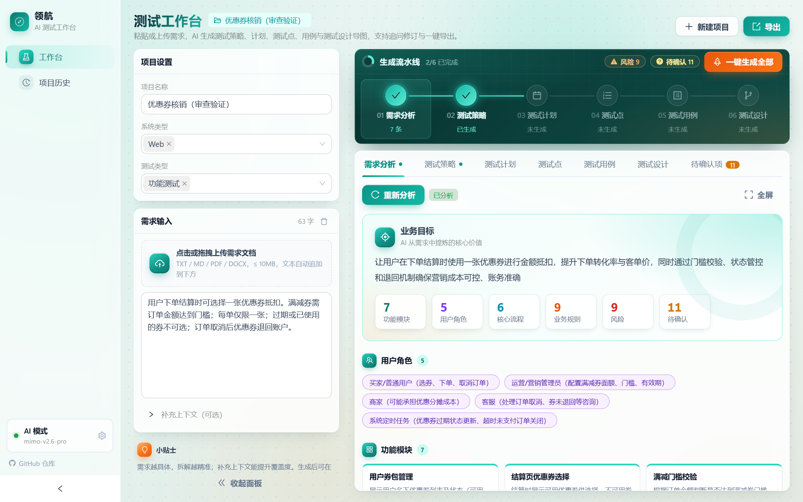
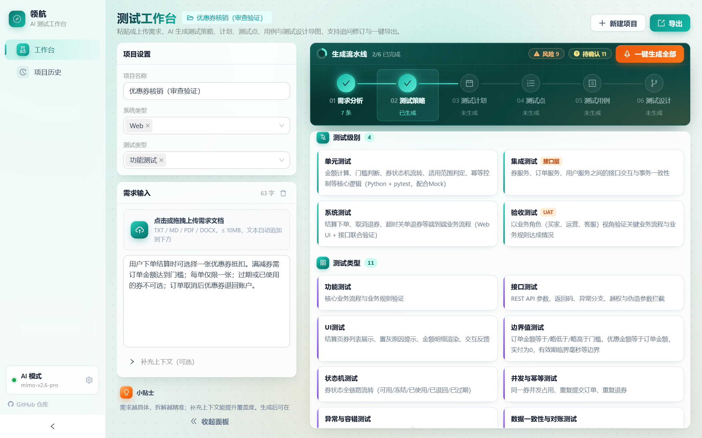
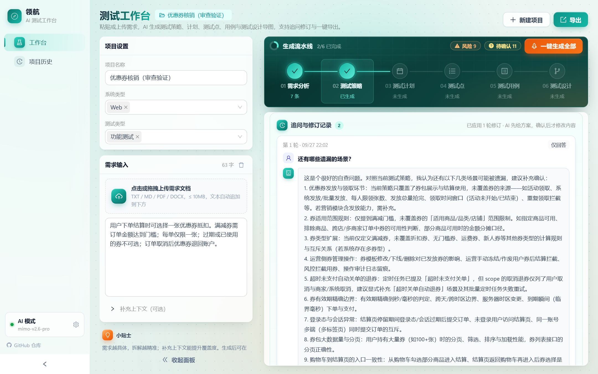
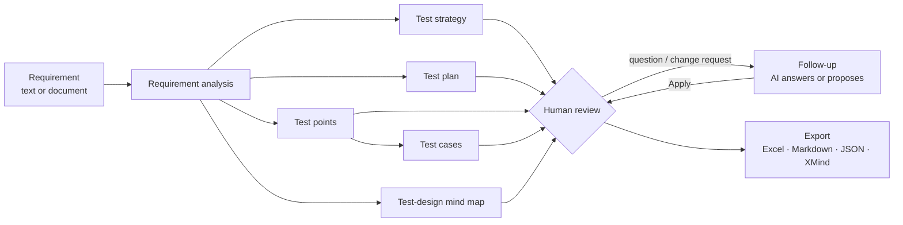

<div align="center">

# TestPilotAgent

**An AI quality workbench that turns requirement documents into reviewable test assets.**

[English](./README.md) | [简体中文](./README.zh-CN.md)

[](https://github.com/Dream22180971/TestPilotAgent/actions/workflows/ci.yml)
[](./testpilot-api/requirements.txt)
[](./testpilot-web/package.json)
[](./testpilot-api/requirements.txt)
[](./LICENSE)



</div>

---

## 🎯 What it is

TestPilotAgent (领航) is a local-first workbench for test engineers. Paste or upload a requirement and it produces six linked modules — **requirement analysis → test strategy → test plan → test points → test cases → test-design mind map** — that you review, refine through follow-up questions and export.

> The model drafts. A tester reviews, questions and decides. Nothing is overwritten without confirmation.

## 💡 Why

Test design usually starts from a blank page: re-reading the PRD, listing modules, guessing edge cases, formatting cases into Excel. Most of that is structured, repetitive work. TestPilotAgent does the first draft in a fixed, schema-validated structure so review time goes to judgment instead of typing.

---

## 🎬 Demo

| Structured output | Follow-up & revision log |
|---|---|
|  |  |
| Long model output is rendered as cards, grouped lists, timelines and milestones. | The AI answers first; proposed edits are applied only after you click **Apply**. Every round is saved. |

Screenshots are from a local run on the included demo requirement (coupon checkout).

---

## ⚡ Quick Start

Requirements: **Python 3.11**, **Node.js 22** (CI uses 22), optional API key for any OpenAI-compatible model.

### Option A — Windows scripts

The scripts expect a virtual environment at the repository root:

```powershell
git clone https://github.com/Dream22180971/TestPilotAgent.git
cd TestPilotAgent
python -m venv .venv
.venv\Scripts\pip install -r testpilot-api\requirements.txt
cd testpilot-web; npm install; cd ..
```

Then start each service in its own terminal:

```powershell
.\start-api.ps1   # FastAPI on http://127.0.0.1:8000
.\start-web.ps1   # Next.js on http://127.0.0.1:3000
```

### Option B — Manual (any OS)

```bash
# Terminal 1 — backend
cd TestPilotAgent/testpilot-api
pip install -r requirements.txt
cp .env.example .env          # optional: add an API key
uvicorn app.main:app --reload --port 8000
```

```bash
# Terminal 2 — frontend
cd TestPilotAgent/testpilot-web
npm install
npm run dev
```

Open **http://127.0.0.1:3000**. API docs are at `http://127.0.0.1:8000/docs`, health check at `/health`.

No API key? Everything still runs: generation falls back to a built-in rule engine, so you can try the full flow offline. Follow-up questions need a model.

---

## ✨ Features

| Area | What you get |
|---|---|
| Input | Paste text or upload TXT / MD / PDF / DOCX (≤ 10 MB); uploaded text is appended, never overwrites what you typed |
| Generation pipeline | Six modules generated one by one or all at once; missing upstream modules are generated automatically |
| Live progress | Streaming model reasoning, per-module status, elapsed time, stop button that keeps finished modules |
| Structured output | Every module is validated against a Pydantic schema before it is saved; long text is rendered as cards, grouped lists, timelines |
| Follow-up & revision log | Ask questions or request changes per module; the AI answers or proposes a revision, you **Apply** or **Discard**; all rounds are persisted |
| Test cases | Filterable table, centered detail dialog with previous / next navigation |
| Mind map | Infinite canvas (drag to pan, wheel to zoom, edit nodes); export XMind / FreeMind / Markdown / PNG / SVG |
| Export | Excel (Chinese headers, wrapped cells), Markdown or JSON for any generated modules |
| Project history | Reopen a project to restore its requirement, documents, all generated modules and revision log |
| Model settings | Any OpenAI-compatible endpoint (DashScope by default); change key / model / base URL in the app, test the connection, pick from the provider's model list |

---

## 🔄 Workflow



Each module is generated by the configured model and validated against its schema; if the model is unavailable or returns invalid output, the rule engine produces a fallback so the pipeline never stalls.

---

## 🧩 Architecture

```text
testpilot-web  (Next.js 14 · React 18 · Ant Design 5)
 ├─ Workspace   pipeline board · module views · follow-up log · export
 ├─ History     reopen projects with all saved results
 └─ services    fetch + SSE client for streaming generation
        │  HTTP / Server-Sent Events
testpilot-api  (FastAPI · SQLAlchemy · Pydantic)
 ├─ routes      projects · requirements · documents · generate/stream · followup · export · settings
 ├─ services    LLM client · prompt loader · schema validation · rule-engine fallback · Excel/Markdown export
 └─ storage     SQLite by default, any SQLAlchemy URL via DATABASE_URL
        │  OpenAI-compatible Chat Completions (streaming, optional reasoning)
   LLM provider (DashScope, DeepSeek, Moonshot, OpenAI, …)
```

<details>
<summary>🗂 Project structure</summary>

```text
TestPilotAgent/
├─ testpilot-api/
│  ├─ app/
│  │  ├─ api/routes/        # REST + SSE endpoints
│  │  ├─ prompts/           # prompt templates per module
│  │  ├─ schemas/           # request and output schemas
│  │  ├─ services/          # generation, follow-up, export, LLM client
│  │  └─ models.py          # SQLAlchemy models
│  ├─ tests/                # pytest suite (rule-engine mode, fake LLM)
│  └─ .env.example
├─ testpilot-web/
│  └─ src/
│     ├─ app/               # workspace and history pages, styles
│     ├─ components/        # workbench components
│     ├─ hooks/             # workspace state
│     └─ services/          # API client
├─ examples/                # sample requirement document
├─ start-api.ps1
└─ start-web.ps1
```

</details>

---

## ⚙️ Configuration

`testpilot-api/.env` (see [`.env.example`](./testpilot-api/.env.example)); values saved in the in-app settings dialog are written here too.

| Variable | Default | Purpose |
|---|---|---|
| `DASHSCOPE_API_KEY` / `LLM_API_KEY` | empty | Model API key; empty = rule-engine mode |
| `LLM_MODEL` | `qwen3-vl-flash-2026-01-22` | Model name |
| `LLM_BASE_URL` | DashScope compatible endpoint | Any OpenAI-compatible base URL |
| `DATABASE_URL` | `sqlite:///./testpilot.db` | SQLAlchemy URL (relative to the directory the API starts in) |
| `CORS_ORIGINS` | `http://127.0.0.1:3000,http://localhost:3000` | Browser origins allowed to call the API |

The frontend reads `NEXT_PUBLIC_API_BASE_URL` (default `http://127.0.0.1:8000`).

---

## 🔐 Privacy & Security

- Runs locally; requirements, generated assets and revision history stay in your own database.
- Requirement text and uploaded documents are sent to the model provider you configure. Use rule-engine mode (no key) for material that must not leave your machine.
- The API has no user accounts and is meant for local use. CORS is limited to the local frontend, and a stored API key is only ever sent to the stored base URL — changing the endpoint requires entering its key.

---

## 🧪 Testing

```bash
cd testpilot-api
pip install -r requirements.txt pytest httpx
python -m pytest -q
```

The suite runs the full pipeline in rule-engine mode and uses a fake streaming model for follow-ups, so it needs no API key or network. It covers pipeline ordering, schema normalization, document context, the answer / propose / apply / discard follow-up flow, export, CORS and API-key handling. CI also builds the frontend (`npm run build`) on every pull request.

---

## ⚠️ Current Limitations

- Generated assets are drafts; they still need a tester's review.
- Single-user, local tool: no authentication, roles or multi-user collaboration.
- Scanned or image-heavy PDFs are not OCR'd; only extractable text is used.
- Output quality depends on the chosen model; the rule-engine fallback is intentionally basic.
- No automated test-script generation or execution yet.

---

## 🗺 Roadmap

**L1 · Reliable core workflow**

- [x] Document upload and parsing
- [x] Streaming generation pipeline with rule-engine fallback
- [x] Schema-validated structured output
- [x] Follow-up with confirm-before-apply and persistent revision log
- [x] Excel / Markdown / JSON export; XMind / FreeMind mind-map export
- [x] Any OpenAI-compatible model, switchable in the app
- [ ] Regular dogfooding on real projects

**L2 · Knowledge**

- [ ] Retrieval over historical test cases
- [ ] Project-specific memory and reusable asset library

**L3 · Agentic QA**

- [ ] Review agent · execution agent · archive agent
- [ ] Test-script generation from cases

**L4 · AI quality workbench**

- [ ] Prompt regression and golden datasets
- [ ] RAG / agent-trajectory evaluation
- [ ] CI quality gates for generated assets

---

## 🤝 Contributing

Issues and pull requests are welcome. Especially useful: document parsers, output schemas, export formats, model adapters and real-world QA workflow examples. Please run the test suite and `npm run build` before opening a PR.

## 📄 License

[MIT](./LICENSE)

<div align="center">

**AI should take over repetitive test-design work, not the tester's judgment.**

</div>
