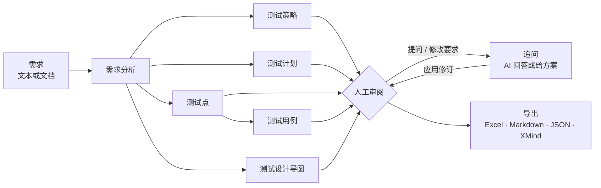

<div align="center">

# TestPilotAgent · 领航

**把需求文档变成可审阅测试资产的 AI 测试工作台。**

[English](./README.md) | [简体中文](./README.zh-CN.md)

[](https://github.com/Dream22180971/TestPilotAgent/actions/workflows/ci.yml)
[](./testpilot-api/requirements.txt)
[](./testpilot-web/package.json)
[](./testpilot-api/requirements.txt)
[](./LICENSE)


</div>

---

## 🎯 它是什么

领航是给测试工程师用的本地 AI 工作台。粘贴或上传一份需求，它会依次产出六个相互关联的模块——**需求分析 → 测试策略 → 测试计划 → 测试点 → 测试用例 → 测试设计导图**，你可以逐个审阅、追问修订，最后一键导出。

> 模型负责打草稿，测试负责审阅、追问和拍板。未经你确认，任何内容都不会被覆盖。

## 💡 为什么做

测试设计往往从一张白纸开始：反复读 PRD、拆模块、想边界、再把用例一条条敲进 Excel。这里面大部分是有固定结构的重复劳动。领航按固定且经过 Schema 校验的结构先把初稿写出来，让评审时间花在判断上，而不是花在打字上。

---

## 🎬 演示

| 结构化输出 | 追问与修订记录 |
|---|---|
|  |  |
| 模型给出的长文本会被整理成卡片、分组清单、时间线和里程碑。 | AI 先回答或给出修订方案，点「应用修订」才会生效，每一轮都会留档。 |

截图来自本地运行，使用的是仓库自带的演示需求（优惠券结算）。

---

## ⚡ 快速开始

环境要求：**Python 3.11**、**Node.js 22**（与 CI 一致）；模型 API Key 可选，支持任意 OpenAI 兼容服务。

### 方式一：Windows 脚本

脚本默认使用仓库根目录下的虚拟环境：

```powershell
git clone https://github.com/Dream22180971/TestPilotAgent.git
cd TestPilotAgent
python -m venv .venv
.venv\Scripts\pip install -r testpilot-api\requirements.txt
cd testpilot-web; npm install; cd ..
```

然后分别在两个终端里启动：

```powershell
.\start-api.ps1   # 后端 FastAPI：http://127.0.0.1:8000
.\start-web.ps1   # 前端 Next.js：http://127.0.0.1:3000
```

### 方式二：手动启动（任意系统）

```bash
# 终端 1：后端
cd TestPilotAgent/testpilot-api
pip install -r requirements.txt
cp .env.example .env          # 可选：填入 API Key
uvicorn app.main:app --reload --port 8000
```

```bash
# 终端 2：前端
cd TestPilotAgent/testpilot-web
npm install
npm run dev
```

浏览器打开 **http://127.0.0.1:3000**。接口文档在 `http://127.0.0.1:8000/docs`，健康检查是 `/health`。

没有 API Key 也能跑：生成会自动退回内置规则引擎，完整流程可以离线体验；只有追问功能必须接入模型。

---

## ✨ 核心功能

| 模块 | 能做什么 |
|---|---|
| 需求输入 | 直接粘贴，或上传 TXT / MD / PDF / DOCX（≤ 10MB）；上传的文本追加到输入框，不会覆盖你已经写的内容 |
| 生成流水线 | 六个模块可单独生成，也可一键全部生成；缺少的上游模块会自动先补齐 |
| 实时进度 | 流式展示模型思考过程、每个模块的状态和耗时；可随时停止，已完成的模块会保留 |
| 结构化输出 | 每个模块保存前都经过 Pydantic Schema 校验；长文本自动整理成卡片、分组清单、时间线 |
| 追问与修订记录 | 针对单个模块提问或提修改要求；AI 先回答或给出修订方案，由你「应用」或「放弃」；每一轮都持久保存 |
| 测试用例 | 可筛选的用例表格，详情以居中弹窗展示，支持上一条 / 下一条 |
| 测试设计导图 | 无限画布：空白处拖动平移、滚轮缩放、节点可编辑；导出 XMind / FreeMind / Markdown / PNG / SVG |
| 导出 | 任选已生成模块，导出 Excel（中文表头、自动换行）、Markdown 或 JSON |
| 项目历史 | 重新打开项目时，恢复需求、文档、全部生成结果和修订记录 |
| 模型配置 | 支持任意 OpenAI 兼容服务（默认阿里云百炼 DashScope）；在界面里修改 Key / 模型 / Base URL，可测试连接、拉取模型列表 |

---

## 🔄 工作流程



每个模块都由配置好的模型生成，并按对应 Schema 校验；模型不可用或返回的格式不合法时，由规则引擎兜底，流水线不会卡住。

---

## 🧩 架构

```text
testpilot-web  (Next.js 14 · React 18 · Ant Design 5)
 ├─ 工作台      流水线看板 · 模块视图 · 追问记录 · 导出
 ├─ 项目历史    重新打开项目并恢复全部结果
 └─ services    fetch + SSE 流式生成客户端
        │  HTTP / Server-Sent Events
testpilot-api  (FastAPI · SQLAlchemy · Pydantic)
 ├─ routes      项目 · 需求 · 文档 · 流式生成 · 追问 · 导出 · 模型配置
 ├─ services    LLM 客户端 · Prompt 模板 · Schema 校验 · 规则引擎兜底 · Excel/Markdown 导出
 └─ storage     默认 SQLite，可通过 DATABASE_URL 切换任意 SQLAlchemy 数据库
        │  OpenAI 兼容 Chat Completions（流式，可选思考过程）
   模型服务（百炼 DashScope、DeepSeek、Moonshot、OpenAI 等）
```

<details>
<summary>🗂 项目结构</summary>

```text
TestPilotAgent/
├─ testpilot-api/
│  ├─ app/
│  │  ├─ api/routes/        # REST + SSE 接口
│  │  ├─ prompts/           # 各模块的 Prompt 模板
│  │  ├─ schemas/           # 请求与输出 Schema
│  │  ├─ services/          # 生成、追问、导出、LLM 客户端
│  │  └─ models.py          # SQLAlchemy 数据模型
│  ├─ tests/                # pytest 测试（规则引擎模式 + 模拟模型）
│  └─ .env.example
├─ testpilot-web/
│  └─ src/
│     ├─ app/               # 工作台与历史页、样式
│     ├─ components/        # 工作台组件
│     ├─ hooks/             # 工作台状态
│     └─ services/          # API 客户端
├─ examples/                # 示例需求文档
├─ start-api.ps1
└─ start-web.ps1
```

</details>

---

## ⚙️ 配置

后端配置在 `testpilot-api/.env`（参考 [`.env.example`](./testpilot-api/.env.example)）；在界面「模型配置」里保存的值也会写入这个文件。

| 变量 | 默认值 | 说明 |
|---|---|---|
| `DASHSCOPE_API_KEY` / `LLM_API_KEY` | 空 | 模型 API Key；留空即规则引擎模式 |
| `LLM_MODEL` | `qwen3-vl-flash-2026-01-22` | 模型名称 |
| `LLM_BASE_URL` | 百炼兼容模式地址 | 任意 OpenAI 兼容 Base URL |
| `DATABASE_URL` | `sqlite:///./testpilot.db` | SQLAlchemy 连接串（相对路径以后端启动目录为准） |
| `CORS_ORIGINS` | `http://127.0.0.1:3000,http://localhost:3000` | 允许从浏览器调用 API 的来源 |

前端读取 `NEXT_PUBLIC_API_BASE_URL`（默认 `http://127.0.0.1:8000`）。

---

## 🔐 隐私与安全

- 本地运行，需求、生成的测试资产和修订记录都保存在你自己的数据库里。
- 需求正文和上传的文档会发送给你配置的模型服务。不能外发的资料请用规则引擎模式（不配 Key）。
- API 没有账号体系，定位是本机使用：CORS 只放行本地前端；已保存的 API Key 只会发往已保存的 Base URL，更换服务地址时必须同时填写对应的 Key。

---

## 🧪 测试

```bash
cd testpilot-api
pip install -r requirements.txt pytest httpx
python -m pytest -q
```

测试在规则引擎模式下跑完整条流水线，追问部分使用模拟的流式模型，不需要 API Key，也不需要联网。覆盖范围包括：流水线顺序、Schema 补齐、文档上下文、追问的「回答 / 给方案 / 应用 / 放弃」流程、导出、CORS 与 API Key 保护。CI 在每个 PR 上还会构建前端（`npm run build`）。

---

## ⚠️ 当前局限

- 生成的测试资产是初稿，仍需测试人员审阅。
- 单机单用户工具：没有登录、角色和多人协作。
- 扫描件或图片为主的 PDF 不做 OCR，只使用可提取的文本。
- 输出质量取决于所选模型；规则引擎兜底刻意保持简单。
- 暂不支持自动生成或执行测试脚本。

---

## 🗺 路线图

**L1 · 可靠的核心流程**

- [x] 文档上传与解析
- [x] 流式生成流水线 + 规则引擎兜底
- [x] 结构化输出与 Schema 校验
- [x] 追问「先方案后应用」+ 持久化修订记录
- [x] Excel / Markdown / JSON 导出，导图 XMind / FreeMind 导出
- [x] 支持任意 OpenAI 兼容模型，可在界面切换
- [ ] 在真实项目中持续自用打磨

**L2 · 知识沉淀**

- [ ] 历史用例检索增强
- [ ] 项目级记忆与可复用测试资产库

**L3 · Agent 化测试**

- [ ] 评审 Agent · 执行 Agent · 归档 Agent
- [ ] 由用例生成测试脚本

**L4 · AI 质量工作台**

- [ ] Prompt 回归与黄金数据集
- [ ] RAG / Agent 轨迹评测
- [ ] 面向生成资产的 CI 质量门禁

---

## 🤝 参与贡献

欢迎提 Issue 和 PR。特别欢迎：文档解析器、输出 Schema、导出格式、模型适配，以及真实测试场景的使用案例。提 PR 前请先跑一遍测试和 `npm run build`。

## 📄 许可证

[MIT](./LICENSE)

<div align="center">

**AI 应该接走重复的测试设计工作，而不是接走测试人员的判断。**

</div>
